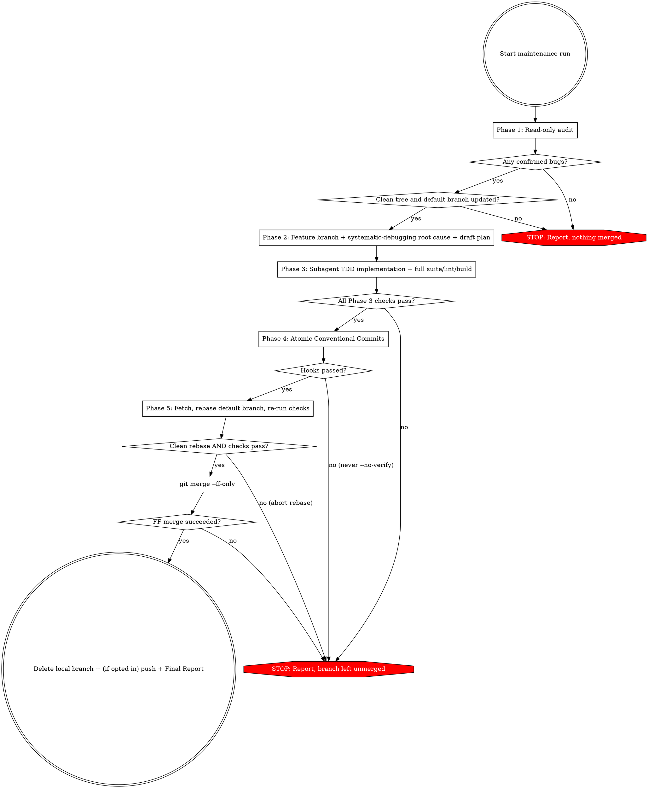

# Code Medic

## Overview

Run an unattended, five-phase repository maintenance pass: read-only bug discovery, branch creation with root-cause diagnosis (`systematic-debugging`) and TDD planning (`draft`), plan execution, atomic Conventional Commits, and rebase + fast-forward merge into the default branch.

**Core principle:** Every phase has a hard entry and exit gate. **Violating the letter of the workflow is violating the spirit of the workflow.**

**Unattended means no human answers questions.** Never wait for input. Where a sub-skill or mode asks your human partner to choose or approve something, use the choice this skill specifies and continue. When a gate fails, stop and report instead of asking.

**Default branch:** `<default>` below means the repository's default branch (`git symbolic-ref --short refs/remotes/origin/HEAD`, minus the `origin/` prefix). If it cannot be determined, stop and report.

## Phase Gate Flowchart



## Quick Reference

| Phase | Working Tree / Branch | Required Sub-Skill / Mode / Model Tier | Stop Condition |
|---|---|---|---|
| **1. Find bugs** | Read-only (no edits, no branches, no commits) | Delegate broad file sweeps to a read-only research subagent if your harness has one | Zero confirmed bugs → report and end run |
| **2. Branch & plan** | Clean `<default>` → `fix/<short-bug-summary>-<YYYYMMDD>` | `systematic-debugging` (root cause before planning) → `draft` (write implementation plan) | Dirty working tree or `--ff-only` pull failure on `<default>` → leave uncommitted work untouched and stop |
| **3. Execute** | Feature branch from Phase 2 | If parent context `>= 75K` tokens or `2+` TDD tasks: hand off **Phases 3–5** to 1 fresh-context Coordinator `self` subagent (`Workspace: "inherit"`, `< 20K` prompt) that dispatches `self` workers sequentially one by one (`Workspace: "inherit"`, `Model: "inherit"`) under `test-driven-development` | Any test, linter, or build failure not fixable within plan scope → leave branch unmerged and stop |
| **4. Commit** | Feature branch | Coordinator (if handed off in Phase 3) or `< 75K` parent | Hook failure → do NOT use `--no-verify`; stop and report |
| **5. Merge** | Rebase feature branch onto `<default>`, `--ff-only` merge into `<default>`; push only if opted in | Coordinator (if handed off in Phase 3) or `< 75K` parent (leave finished subagents idle) | Rebase conflict, post-rebase check failure, timeout risk, `--ff-only` failure, or push failure → abort/stop and report |

---

## Phase 1: Find Bugs (Read-Only)

**Strict read-only rule:** Do not modify tracked files, create temporary files in the repo, create branches, or commit during this phase.
- **No "ephemeral" edits or repo-local scratch files:** Do not edit repository files with the intention of running `git checkout` or `git clean` afterward, and never write scratch/baton files inside the repository working tree; store session batons strictly in the harness session/artifact directory. Verify hypotheses by running existing tests or one-liner commands (`node -e`, `python -c`, `pytest -k`).
- **Turn-1 Prefix, Tool & Model Freeze (Prevent Cache-Bust Cascades):** Load deferred/lazy tools (such as `LSP` via `ToolSearch` or lazy MCP tool schemas) on Turn 1 before starting exploration. Never modify `AGENTS.md`, `CLAUDE.md`, rule files, active `SKILL.md` files, or MCP configs during a maintenance run, keep gaps between LLM turns `< 4` minutes inside active loops (via scoped tests or a capped keep-alive timer; a parent awaiting the Coordinator handoff wakes once at completion) so the 5-minute prompt-cache TTL never expires, and pin one orchestrator model for the whole run (default subagents to `Model: "inherit"` and never switch the parent UI model mid-session; if a parent model switch is unavoidable, run `/compact` first).

1. Read repository guidance (`README`, `AGENTS.md`, `CLAUDE.md`, `CONTRIBUTING`, `docs/`) and understand the architecture.
2. **Context Isolation (`<= 60K–80K` Target, `150K` Parent Token Cap):** Keep the main orchestrator context small (`<= 60K–80K` target, `150K` hard cap; past `~155K–200K` tokens opportunistic implicit prefix caches can drop to `0%` on follow-up and post-spawn yield turns). Delegate broad codebase sweeps (more than a handful of files) to parallel read-only research subagents if available, enforcing a **`<= 20`-line return contract** per subagent: return only confirmed bug candidates (`file:line`, 1-line trigger, 1-line reproduction result, and exact initializer signatures needed to write a test) plus 1 summary line for ruled-out files—never raw command/file dumps. While sibling research subagents are still running, yield immediately with **zero tool calls** (`tools=[]`) on intermediate wakeups and checkpoint `inventory.md` once after the wave completes via surgical `edit_file` diffs (never full-file `write_file` rewrites). If verifying a hypothesis requires multi-step standalone harness compilation, offload it to a single bounded subagent or `ctx_execute` script (`<= 20` output lines) rather than iterating compile-fix loops in the parent. Without subagents, read in line-bounded slices and keep notes short.
3. **Strict Phase 1 Parent Verification Cap (`<= 3` Turns AND `<= 6` Slices, `< 65K–75K` Tokens Entering Phase 2):** Trust research subagents' reported initializer/method signatures and reproduction results; perform at most `<= 3` targeted turns and `<= 6` total `read_file` slices (`<= 80` lines each) in the parent context. If `4+` bug candidates or cross-file call chains remain to confirm, delegate finalist verification (signatures, line numbers, repro failure output) to **one dedicated read-only `research` verifier subagent** (`<= 20`-line return) instead of loading dozens of slices into the parent. In interactive runs approaching `~75K–80K` tokens after Phase 2, `/compact` before Phase 3; in unattended runs, hand off Phases 3–5 to the fresh-context Coordinator.
4. Separate confirmed bugs from hypotheses. Ignore style-only, typo-only, or speculative issues (e.g., defensive guards for inputs already rejected by upstream validators).
5. Output the **Phase 1 Audit Report** using this exact structure:

```markdown
### Phase 1 Audit Report
- **Area Explored:** [files, modules, and git history inspected]
- **Validation Limitations:** [any constraints on reproduction or test execution]
- **Confirmed Bugs:** [count]

#### Bug [N]: [Short Title]
- **Severity:** [Critical | High | Medium | Low]
- **Location:** `path/to/file:line`
- **Triggering Scenario:** [exact inputs/conditions that trigger the failure]
- **Expected vs. Actual Behavior:** Expected [X]; actually does [Y]
- **Reproduction / Test Evidence:** [exact command run and observed failure output]
- **Suggested Fix:** [focused description of code change]
```

**Stop condition:** If `Confirmed Bugs` is `0`, output the Phase 1 Audit Report and **end the run immediately**. Do not continue to Phase 2.

---

## Phase 2: Branch and Implementation Plan

1. Verify the working tree is clean (`git status --porcelain` must be empty). If it is dirty, **stop and report**—never stash, reset, clean, or check out over uncommitted work.
2. Fetch, update `<default>`, and create the feature branch:
   ```bash
   git fetch origin
   git checkout <default> && git pull --ff-only
   git checkout -b fix/<short-bug-summary>-<YYYYMMDD>
   ```
   If any command fails, stop and report. Never implement directly on `<default>`.
3. **Find the root cause before writing the plan (`systematic-debugging`):** Before invoking `draft` or drafting tasks, invoke the `systematic-debugging` global agent skill for each confirmed bug from Phase 1 to verify its true underlying root cause—never plan directly from Phase 1's symptom location or initial `Suggested Fix` unverified:
   - **Diagnosis scope (stop before editing):** Follow `systematic-debugging`'s triage checklist through root-cause identification—Reproduce (reusing Phase 1's focused evidence rather than re-running full suites), Localize (`git bisect` if a regression), Reduce to the minimal failing case, and trace data/control flow asking *"Why does this happen?"* until reaching the actual cause rather than a symptom guard. Stop before applying fixes or permanent tests (Phase 3 implements fixes via `test-driven-development`).
   - **Keep the branch clean:** Prefer read-only call-chain tracing, `git bisect`, and focused minimal repro commands. If you run `git bisect` or temporary diagnostic instrumentation on the feature branch, reset/remove it (`git bisect reset`, clean `git status --porcelain`) before invoking `draft`.
   - **Re-check confirmation & context cap:** Merge symptoms that share one root cause into one task; drop any candidate disproved as a false positive (if `0` confirmed bugs remain, switch back to `<default>`, delete the empty feature branch, and stop and report). For `4+` bugs or deep cross-file chains, delegate root-cause tracing to a bounded read-only subagent (`<= 20`-line summary per bug) so parent context stays `< 75K` entering planning/Phase 3.
4. **Write the implementation plan (`draft`):** Invoke the `draft` skill to turn the root-cause-confirmed bugs into an ordered, step-by-step implementation plan (keeping production and test code read-only until Phase 3).
   - **No size exemptions:** Override `draft`'s single-file / small-scope exemption—write and save the plan even for a single 1-line bug fix, keeping each task concise (`<= 20` lines: verified root cause, target `file:line`, owned test file, verified initializer signatures, RED assertion, GREEN root-cause fix).
   - **Sequence one bug per task cleanly:** Map each bug to a self-contained task (prefer each component's existing test file) and keep hunks separable per bug for Phase 4's one-commit-per-bug rule even when multiple bugs touch the same file.
   - **TDD steps, no commits:** Each bug in the plan MUST specify a failing test step first (RED), then the minimal fix step (GREEN), ending at a green focused test run—leave out per-task commit steps (commits belong to Phase 4).
   - **Plan path (`docs/plans/`):** Override `draft`'s default `tasks/plan.md` and `tasks/todo.md` outputs—save the plan (including its task list) directly to `docs/plans/` (e.g., `docs/plans/YYYY-MM-DD-<short-bug-summary>.md`, or following the repository's existing naming convention in `docs/plans/`) on the feature branch, and do not create `tasks/plan.md` or `tasks/todo.md`. Record the path for the Final Report.
   - **No human handoff:** Skip `draft`'s interactive plan-mode prompt, human review/approval checkpoints, `Open Questions`, and `tasks/` conflict prompts—nobody is there to answer. Proceed directly to Phase 3, delegating implementation tasks to subagents under the `test-driven-development` global agent skill.

---

## Phase 3: Execute

1. Stay on the feature branch created in Phase 2.
2. **Phase 3–5 Fresh-Context Coordinator Handoff (`>= 75K` Parent or `2+` TDD Tasks):** In unattended runs where `/compact` cannot be typed interactively between Phase 2 and Phase 3, if parent context is `>= 75K` tokens **or** Phase 3 executes `2+` sequential TDD tasks (whose sequential completions would otherwise bloat a `130K–150K+` parent or drop its large prefix cache across waits), delegate **Phases 3, 4, and 5** (dispatching sequential `Workspace: "inherit"` workers one by one, running Phase 3 verification, creating Phase 4 atomic commits, and completing Phase 5 rebase + post-rebase verification + `--ff-only` merge + branch delete + opt-in push) to **one fresh-context Coordinator `self` subagent** (`Workspace: "inherit"`, `< 20K` initial prompt tokens). Require a single `<= 20`-line summary covering Phase 3 & Phase 5 check results, commit hashes, merge/push status, and any Stop Condition blocker, so the parent wakes only once at completion to print the Final Report (leave completed subagents idle; never call `manage_subagents` `kill` / `kill_all`).
3. **Dispatch sequential per-bug workers one by one (`Workspace: "inherit"`, No Parallel Fix Workers, No Inline Edits):** The Coordinator (or `< 75K` parent) executes bug tasks strictly **one by one in sequence**, spawning one `self` subagent at a time (`invoke_subagent` with `TypeName: "self"`, `Workspace: "inherit"`, `Model: "inherit"`) and waiting for it to finish before spawning the next. Never dispatch multiple fix workers in parallel (no `Workspace: "share"` worktrees or concurrent test runs). Fall back to inline execution **only** if your harness has no subagent tool. When subagents are available, the orchestrator **MUST NOT** edit production/test files or run per-bug RED/GREEN loops inline—doing so inflates prompt context past `~150K–200K` tokens and triggers cache-bust cascades.
   - **REQUIRED SUB-SKILL:** Instruct each subagent to use `test-driven-development` (from global agent skills) for its assigned bug(s): write the failing test and watch it fail (RED), apply the minimal fix (GREEN), then refactor.
   - **Dry-Reference Worker Prompts (`<= 1,500` Output Tokens per Dispatch Turn) & Repo Boundaries:** Put detailed task specs, verified initializer signatures, and shared TDD rules once inside `docs/plans/...`, and keep each `invoke_subagent` prompt to `<= 15–20` lines referencing `docs/plans/...` plus the task number—never duplicate `10K+` tokens of inline specs in a dispatch turn. Instruct each subagent **not** to commit, stash, reset, or switch branches, **not** to revert or modify earlier workers' uncommitted changes or files outside its assigned scope, and **not** to wait for human input—leave edits uncommitted on the feature branch.
   - **`<= 20`-Line Return Contract (No Raw Stdout Dumps):** Require every worker's final reply to stay `<= 20` lines containing only: (1) modified/created relative file paths, (2) 1-line RED failure confirmation, (3) 1-line GREEN pass count/duration, and (4) a 2-line `Root cause` / `Fix` summary for Phase 4. Forbid pasting raw build or test stdout.
   - **Sequential Boundaries & Idle Subagents:** Wait for the active worker to finish before launching the next task, checkpoint `inventory.md` via `edit_file` only at phase boundaries, and leave finished subagents idle instead of calling `manage_subagents` `kill` / `kill_all` so completed workers and `Workspace: "inherit"` subagents are not marked **Cancelled**.
   - **Zero-Rework & Narrowly Scoped RED Tests:** Before writing a failing test in the plan or test file, verify the exact constructor/initializer signatures of all referenced types (and run fast static/LSP diagnostics when available) so the RED test compiles on the first attempt without burning extra compile-fix turns. Scope every RED/GREEN run strictly to the single focused test (`--filter`, `-only-testing:`, `-k`, `-run`), skipping unrelated targets, linters, and bundling until full verification.
   - **Strict RED → GREEN Serialization & Cache Keep-Alive:** When a RED test run is backgrounded as an async task, wait for it to finish and confirm the test failure before applying GREEN production edits. Never apply and revert production edits while a RED test is still compiling (only read-only inspection of target production lines is safe during the wait). Because backgrounding prevents tool timeouts—**not** the 5-minute LLM cache TTL—whenever waiting on a backgrounded test run, verification suite, or active sequential worker that could take `>= 3.5–4` minutes (and your harness offers a cancellable one-shot timer like `schedule`), arm `schedule(DurationSeconds: 210, TimerCondition: "any", Prompt: "Keep-alive: check background task/worker status and re-arm if still running.")` before yielding: fast `< 3.5m` runs auto-cancel the timer with zero overhead, while slower runs wake the agent warm to run one lightweight `manage_task(Action: "status")` / `manage_subagents(Action: "list")` check and re-arm (cap at **2–3 refreshes** ≈ 10–14 min total; beyond that, stop refreshing or trigger the Stop Condition if stalled).
4. Once all implementation tasks complete, verify (inside the Coordinator if delegated, or in the `< 75K` parent) by running the targeted reproduction tests PLUS the project's full test suite, linter, and build. **Avoid tool timeouts and cache drops:** launch any suite or build expected to take `>= 3–4` minutes in the background redirected to a log file (rather than blocking inside a synchronous wrapper like `ctx_execute`) so the turn completes cleanly without timing out, pair the wait with the capped `210s` `schedule(TimerCondition: "any")` keep-alive above so the 5-minute prompt-cache TTL stays warm, and inspect failure lines only on completion.
5. **Stop condition:** If any subagent reports an unresolvable blocker, or any test, linter, or build step fails and cannot be fixed within the plan's scope, **stop immediately**. Leave the feature branch unmerged and report the failure. Do not modify out-of-scope repository infrastructure (such as `.husky` or build scripts) to force checks to pass.

---

## Phase 4: Commit

Execute inside the warm Coordinator when Phases 3–5 were handed off in Phase 3; otherwise batch on the feature branch in the `< 75K` parent. Commit using Conventional Commits format:

```text
<type>(<scope>): <description>

Root cause: <why the bug occurred>
Fix: <how the change resolves it>
```

- **Allowed types:**
  - `docs(<scope>): <description>` for the implementation plan file
  - `fix(<scope>): <description>` for each bug fix (with its test)
  - `test(<scope>): <description>` for standalone test-only additions
- **One logical commit per bug:** Never bundle multiple distinct bugs into a single commit, even if they touch the same file.
- **Never use `--no-verify`:** Not even as a "last resort" when pre-commit hooks fail on environment/tooling issues (like missing `typedoc`). If a hook fails and cannot be satisfied cleanly without changing hook configs, stop and leave the branch unmerged.

---

## Phase 5: Merge to `<default>` (Rebase + Fast-Forward Only)

Enter Phase 5 **only** if all checks passed in Phase 3 and all commits succeeded without `--no-verify` in Phase 4.

1. Fetch and update the local default branch:
   ```bash
   git fetch origin
   git checkout <default> && git pull --ff-only
   ```
2. Switch to the feature branch and **always** rebase onto `<default>`, even if `<default>` has zero new commits since Phase 2:
   ```bash
   git checkout <feature-branch> && git rebase <default>
   ```
3. **Conflict gate:** If the rebase hits conflicts that cannot be resolved with 100% mechanical certainty, run `git rebase --abort`, leave the feature branch intact, and stop.
4. **Post-rebase verification gate:** Re-run the full test suite, linter, and build on the rebased branch—even if the rebase was a no-op or `<default>` only changed documentation (using backgrounded log-redirected execution plus the capped `210s` `schedule(TimerCondition: "any")` keep-alive for `>= 3.5–4` minute suites/builds so neither tool timeouts nor 5-minute prompt-cache expirations occur). If remaining job time is insufficient to finish the full verification suite, stop and leave the branch unmerged.
5. Switch to `<default>` and fast-forward merge:
   ```bash
   git checkout <default>
   git merge --ff-only <feature-branch>
   ```
   - **Never** create a merge commit and **never** use `--no-ff`.
   - If `git merge --ff-only` fails, do not fall back to another merge strategy. Stop and report.
6. Delete the local feature branch after a successful merge:
   ```bash
   git branch -d <feature-branch>
   ```
7. **Push is opt-in.** Push only if the run's instructions (scheduler prompt, user message, or repo guidance) explicitly say to push the default branch:
   ```bash
   git push origin <default>
   ```
   - Use a plain fast-forward push. **Never force-push `<default>`.**
   - If the push fails (rejected, branch protection, no `origin`), do not retry another way. The local merge is already done, so report "Merged locally, push failed (reason)".
   - If the push was not requested, report "Merged locally, not pushed".
8. **Leave completed subagents idle before concluding:** Never call `manage_subagents` `kill` / `kill_all` on finished subagents (which marks them **Cancelled**); leave completed subagents idle before outputting the Final Report.

---

## Final Report

Conclude every run with this exact summary structure:

```markdown
## Maintenance Run Summary
- **Bugs Found:** [count and 1-line summary per confirmed bug, or "0 confirmed bugs"]
- **Plan File Path:** [`docs/plans/...` or "N/A (stopped before planning)"]
- **Branch Name:** [`fix/...` or "N/A (stopped before branching)"]
- **Commit Hashes:** [list of `<hash> <subject>` per commit, or "None"]
- **Test Results:** [Phase 3 and Phase 5 post-rebase test, linter, and build outcomes]
- **Merge & Push Status:** [Merged to `<default>` via `--ff-only` and pushed | Merged locally, not pushed | Merged locally, push failed (reason) | Unmerged (reason) | N/A]
- **Skipped / Human Review Needed:** [unconfirmed hypotheses, blocked hooks, conflicts, or "None"]
```

---

## Rationalization Table

| Excuse | Reality |
|---|---|
| "Phase 1 already reproduced the bug and gave a Suggested Fix, so I'll jump straight to planning without `systematic-debugging`" | Phase 1 confirms symptoms under a read-only slice cap. Run `systematic-debugging` (Reproduce, Localize, Reduce, trace *"Why?"*) to verify the true root cause before writing the plan so Phase 3 fixes the cause, not a symptom. |
| "Creating a plan in `docs/plans/` for a 1-line fix is process theater / repo clutter" / "`draft` says not to use it for single-file changes" | Phase 2 overrides `draft`'s small-scope exemption: invoke `draft` and save a plan in `docs/plans/` for every run that proceeds past Phase 1. The plan is an auditable artifact committed with `docs:`. |
| "`draft` requires human review/approval before proceeding, so I'll wait for approval" | The run is unattended. Skip `draft`'s human review checkpoints, save the plan to `docs/plans/`, delegate Phase 3 implementation tasks to subagents under `test-driven-development`, and let the stop conditions protect you. |
| "These bug fixes are small, so editing and running RED/GREEN inline in the main session is faster than spawning Phase 3 subagents" | Inline Phase 3 loops bloat the parent prompt past `150K–200K` tokens and trigger multi-dollar cache-bust cascades. Always delegate tasks to fresh subagents when subagent tools exist. |
| "Spawning parallel `Workspace: 'share'` fix workers is faster than sequential `Workspace: 'inherit'` subagents" | Parallel fix worktrees trigger cold rebuilds, shared build/simulator lock contention, and copy-harvest issues. Dispatch sequential `Workspace: "inherit"` subagents one by one inside the Coordinator so incremental builds stay warm and edits land cleanly on the feature branch. |
| "I should rewrite `inventory.md` on every subagent wakeup and ask workers for full RED/GREEN stdout" | Rewriting `inventory.md` frequently and ingesting raw build/test stdout inflates context past the opportunistic-cache cliff (`~155K–200K` tokens). Enforce `<= 20`-line worker summaries and update `inventory.md` via `edit_file` at phase boundaries only. |
| "I'll wrap the full test suite or `.app` packaging script inside a synchronous `ctx_execute` call" | Synchronous calls lasting `>= 4–5` minutes time out or expire the prompt-cache TTL. Background full suites/builds to a log file, keep the cache warm with a capped `210s` `schedule(TimerCondition: "any")` timer if `>= 3.5m`, and read only summary/failure lines. |
| "Backgrounding the RED test automatically protects the 5-minute cache" | Backgrounding only avoids tool timeouts—the 5-minute TTL still expires during silent `>= 4–5m` waits. Scope RED/GREEN to a single focused test and arm a capped `210s` `schedule(TimerCondition: "any")` keep-alive if a wait may reach `>= 3.5–4m`. |
| "Both 1-line bugs are in the same file, so I'll commit them together" / "the maintainer asked for one commit" / "it saves a check run" | Phase 4 requires one logical commit per bug for clean `git revert` and `git bisect`. A requested single commit does not override it; report the conflict instead. |
| "The task says land on the default branch and the push is a clean fast-forward, so I'll commit straight on it" | Work on a feature branch, rebase, verify, then `--ff-only`. Pushing is separate and opt-in. |
| "`<default>` has zero new commits since Phase 2, so `git rebase` and re-running tests is a redundant no-op" | Phase 5 mandates the rebase and re-running tests, linter, and build on the rebased branch every time, without exception. |
| "The incoming commit is docs-only, so it can't interact with the code or tests; a quick unittest run is enough after the rebase" | Phase 5 step 4 requires the full test suite, linter, and build on the rebased branch, every time. A docs-only upstream commit does not exempt you. If the budget cannot cover it, stop and leave the branch unmerged. |
| "The merge is done, so I might as well push" | Push only when the run explicitly says to. Otherwise report "Merged locally, not pushed". |

## Red Flags - STOP

If you catch yourself thinking any of these, **STOP** immediately:
- "Phase 1 already suggested a fix, so I'll skip `systematic-debugging` and invoke `draft` directly..."
- "Proportionality—this fix is too small for `docs/plans/`..."
- "`draft` says to skip single-file plans, write `tasks/plan.md` / `tasks/todo.md`, or wait for human approval..."
- "I already know the fix, so I'll edit the files and run tests inline instead of delegating Phase 3 to subagents..."
- "I'll spawn parallel `Workspace: 'share'` fix workers instead of dispatching sequential `Workspace: 'inherit'` subagents one by one..."
- "I'll run the full test suite or bundle build synchronously inside `ctx_execute`..."
- "I'll wait silently `>= 4m` on a backgrounded test or suite without a keep-alive..."
- "I'll edit `AGENTS.md` / rules mid-run or drop `inventory.md` inside the repo working tree..."
- "`git merge-base` is identical, so I can skip the rebase and post-rebase tests..."
- "I'll just commit on the default branch, a feature branch is overkill..."
- "The merge is done, so I might as well push..."

**All of these mean: Follow the exact phase gate or trigger the phase's Stop Condition.**
