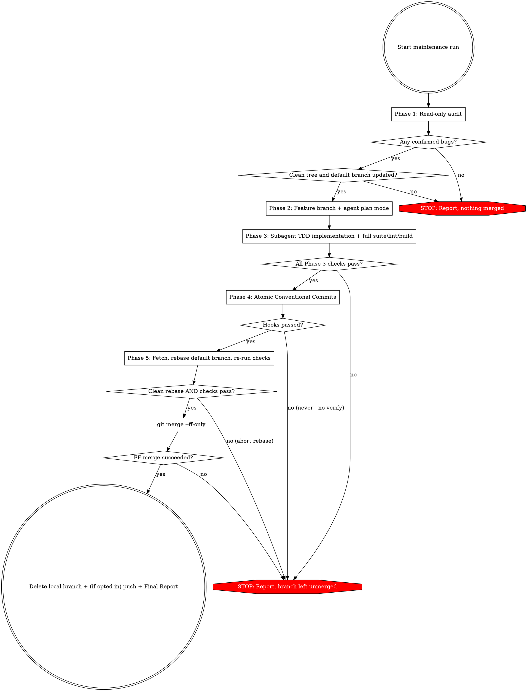

# Code Medic

## Overview

Run an unattended, five-phase repository maintenance pass: read-only bug discovery, branch and TDD plan creation, plan execution, atomic Conventional Commits, and rebase + fast-forward merge into the default branch.

**Core principle:** Every phase has a hard entry and exit gate. **Violating the letter of the workflow is violating the spirit of the workflow.**

**Unattended means no human answers questions.** Never wait for input. Where a sub-skill or mode asks your human partner to choose or approve something, use the choice this skill specifies and continue. When a gate fails, stop and report instead of asking.

**Default branch:** `<default>` below means the repository's default branch (`git symbolic-ref --short refs/remotes/origin/HEAD`, minus the `origin/` prefix). If it cannot be determined, stop and report.

## Phase Gate Flowchart



## Quick Reference

| Phase | Working Tree / Branch | Required Sub-Skill / Mode / Model Tier | Stop Condition |
|---|---|---|---|
| **1. Find bugs** | Read-only (no edits, no branches, no commits) | Delegate broad file sweeps to a read-only research subagent if your harness has one | Zero confirmed bugs → report and end run |
| **2. Branch & plan** | Clean `<default>` → `fix/<short-bug-summary>-<YYYYMMDD>` | Agent plan mode — highest-reasoning tier available | Dirty working tree or `--ff-only` pull failure on `<default>` → leave uncommitted work untouched and stop |
| **3. Execute** | Feature branch from Phase 2 | Dispatch parallel `self` subagents (`Workspace: "share"`, `Model: "flash"` / cheaper tier) across disjoint files in one turn using `test-driven-development` (group/serialize overlapping files) | Any test, linter, or build failure not fixable within plan scope → leave branch unmerged and stop |
| **4. Commit** | Feature branch | Current model | Hook failure → do NOT use `--no-verify`; stop and report |
| **5. Merge** | Rebase feature branch onto `<default>`, `--ff-only` merge into `<default>`; push only if opted in | Current model | Rebase conflict, post-rebase check failure, timeout risk, `--ff-only` failure, or push failure → abort/stop and report |

---

## Phase 1: Find Bugs (Read-Only)

**Strict read-only rule:** Do not modify tracked files, create temporary files in the repo, create branches, or commit during this phase.
- **No "ephemeral" edits or repo-local scratch files:** Do not edit repository files with the intention of running `git checkout` or `git clean` afterward, and never write scratch/baton files inside the repository working tree (e.g., `.superpowers/baton.md`); store session batons strictly in the harness session/artifact directory. Verify hypotheses by running existing tests or one-liner commands (`node -e`, `python -c`, `pytest -k`).
- **Turn-1 Prefix, Tool & Model Freeze (Prevent Cache-Bust Cascades):** Load deferred/lazy tools (such as `LSP` via `ToolSearch` or lazy MCP tool schemas) on Turn 1 before starting exploration. Never modify `AGENTS.md`, `CLAUDE.md`, rule files, active `SKILL.md` files, or MCP configs during a maintenance run, keep every synchronous tool call `< 4` minutes so the 5-minute prompt-cache TTL never expires, and pin one orchestrator model for the whole run (use subagent `Model` overrides for cheaper worker tiers instead of switching the parent UI model mid-session; if a parent model switch is unavoidable, run `/compact` first).

1. Read repository guidance (`README`, `AGENTS.md`, `CLAUDE.md`, `CONTRIBUTING`, `docs/`) and understand the architecture.
2. **Context Isolation (`<= 60K–80K` Target, `150K` Parent Token Cap):** Keep the main orchestrator context small (`<= 60K–80K` target, `150K` hard cap; past `~155K–200K` tokens opportunistic implicit prefix caches can drop to `0%` on follow-up and post-spawn yield turns). Delegate broad codebase sweeps (more than a handful of files) to parallel read-only research subagents if available, enforcing a **`<= 20`-line return contract** per subagent: return only confirmed bug candidates (`file:line`, 1-line trigger, 1-line reproduction result, and exact initializer signatures needed to write a test) plus 1 summary line for ruled-out files—never raw command/file dumps. While sibling research subagents are still running, yield immediately with **zero tool calls** (`tools=[]`) on intermediate wakeups and checkpoint `baton.md` once after the wave completes via surgical `edit_file` diffs (never full-file `write_file` rewrites). If verifying a hypothesis requires multi-step standalone harness compilation, offload it to a single bounded subagent or `ctx_execute` script (`<= 20` output lines) rather than iterating compile-fix loops in the parent. Without subagents, read in line-bounded slices and keep notes short.
3. In the main context, perform only targeted line-bounded reads on the 1–3 finalist files to verify the findings.
4. Separate confirmed bugs from hypotheses. Ignore style-only, typo-only, or speculative issues (e.g., defensive guards for inputs already rejected by upstream validators).
5. Output the **Phase 1 Audit Report** using this exact structure:

```markdown
### Phase 1 Audit Report
- **Area Explored:** [files, modules, and git history inspected]
- **Validation Limitations:** [any constraints on reproduction or test execution]
- **Confirmed Bugs:** [count]

#### Bug [N]: [Short Title]
- **Severity:** [Critical | High | Medium | Low]
- **Location:** `path/to/file:line`
- **Triggering Scenario:** [exact inputs/conditions that trigger the failure]
- **Expected vs. Actual Behavior:** Expected [X]; actually does [Y]
- **Reproduction / Test Evidence:** [exact command run and observed failure output]
- **Suggested Fix:** [focused description of code change]
```

**Stop condition:** If `Confirmed Bugs` is `0`, output the Phase 1 Audit Report and **end the run immediately**. Do not continue to Phase 2.

---

## Phase 2: Branch and Implementation Plan

1. Verify the working tree is clean (`git status --porcelain` must be empty). If it is dirty, **stop and report**—never stash, reset, clean, or check out over uncommitted work.
2. Fetch, update `<default>`, and create the feature branch:
   ```bash
   git fetch origin
   git checkout <default> && git pull --ff-only
   git checkout -b fix/<short-bug-summary>-<YYYYMMDD>
   ```
   If any command fails, stop and report. Never implement directly on `<default>`.
3. Switch to **agent plan mode** to turn the confirmed bugs into a step-by-step implementation plan, then exit plan mode once the plan is ready.
   - **No size exemptions:** Write and save the plan even for a single 1-line bug fix, keeping each task concise (`<= 20` lines: target `file:line`, owned test file, verified initializer signatures, RED assertion, GREEN fix).
   - **Partition for disjoint parallel ownership:** Map each bug to exclusive production file(s) AND exclusive test file(s) (prefer each component's existing test file or a per-worker test file rather than having parallel workers edit one shared catch-all test file simultaneously). Group tasks that touch the same file into a single worker assignment (keeping hunks separable for Phase 4's one-commit-per-bug rule).
   - Each bug in the plan MUST specify a failing test step first (RED), then the minimal fix step (GREEN).
   - **Commits belong to Phase 4:** Plan tasks end at a green test run; leave out per-task commit steps.
   - **Model selection:** Use the highest-reasoning tier available (when delegating, pass `Model: "pro"` or `"inherit"` on a high-reasoning model).
   - **No human handoff:** Do not pause or wait for human review or plan approval—nobody is there to answer. Exit plan mode and proceed directly to Phase 3, delegating implementation tasks to subagents under the `test-driven-development` global agent skill.
   - Save the plan to `docs/plans/` (e.g., `docs/plans/YYYY-MM-DD-<short-bug-summary>.md`, or following the repository's existing naming convention in `docs/plans/`) on the feature branch—writing the file either during plan mode or immediately upon exiting if plan mode is read-only. Record the path for the Final Report.

---

## Phase 3: Execute

1. Stay on the feature branch created in Phase 2.
2. **Dispatch parallel disjoint-file workers (`Workspace: "share"`, No Inline Multi-Bug Edits):** When `2+` tasks touch disjoint source and test files and your harness supports shared worktrees (`Workspace: "share"`), spawn all disjoint `self` subagents **in a single parent turn** (`invoke_subagent` with `TypeName: "self"`, `Workspace: "share"`, `Model: "flash"` or a cheaper tier), reducing `N` sequential `> 5m` TTL expirations and `N` post-spawn yield turns down to `1` batch dispatch and `1` shared wait window. If multiple tasks modify the **same** source or test file, group them into a single `Workspace: "share"` worker (implementing them sequentially inside its worktree while keeping changes cleanly separable for Phase 4) or run overlapping tasks in a second wave. Fall back to sequential `Workspace: "inherit"` subagents only for single-task plans or harnesses without `Workspace: "share"`, and to inline execution **only** if your harness has no subagent tool. When subagents are available, the parent orchestrator **MUST NOT** edit production/test files or run per-bug RED/GREEN loops inline—doing so inflates the parent prompt past `~150K–200K` tokens and triggers cache-bust cascades.
   - **REQUIRED SUB-SKILL:** Instruct each subagent to use `test-driven-development` (from global agent skills) for its assigned bug(s): write the failing test and watch it fail (RED), apply the minimal fix (GREEN), then refactor.
   - **Worktree & subagent boundaries:** Because `Workspace: "share"` creates a separate git worktree from `HEAD` (without uncommitted parent files such as an uncommitted `docs/plans/...`), pass either the **absolute path** to `docs/plans/...` in the parent workspace or inline the worker's concise task spec and verified type signatures directly in the prompt. Instruct each subagent **not** to commit, stash, reset, or switch branches, **not** to touch files outside its assigned scope, and **not** to wait for human input—leave edits uncommitted in its worktree.
   - **`<= 20`-Line Return Contract (No Raw Stdout Dumps):** Require every worker's final reply to stay `<= 20` lines containing only: (1) its worktree root path (`pwd`), (2) modified/created relative file paths, (3) 1-line RED failure confirmation, (4) 1-line GREEN pass count/duration, and (5) a 2-line `Root cause` / `Fix` summary for Phase 4. Forbid pasting raw build or test stdout.
   - **Zero-Tool Intermediate Wakeups & Single-Batch Harvest:** While sibling workers in a parallel wave are still running, yield immediately with **zero tool calls** (`tools=[]`, 1-line status—do **not** rewrite `baton.md` or copy files mid-wave) so staggered `< 4m` completions hit the warm prompt cache at near-zero output cost. Once **all** workers in the wave have reported, copy/apply each worker's owned modified and new files from its worktree (`cp <worktree>/<relpath> <repo>/<relpath>`) into the parent feature-branch working tree in **one batch command**, verify `git status --short` matches expected files, and checkpoint `baton.md` once at the Phase 3 → Phase 4 boundary via `edit_file`.
   - **Zero-Rework RED Tests:** Before writing a failing test in the plan or test file, verify the exact constructor/initializer signatures of all referenced types, so the RED test compiles on the first attempt without burning extra compile-fix turns.
   - **Strict RED → GREEN Serialization:** When a RED test run is backgrounded as an async task, wait for it to finish and confirm the test failure before applying GREEN production edits. Never apply and revert production edits while a RED test is still compiling.
3. Once all implementation tasks complete, verify in the main session by running the targeted reproduction tests PLUS the project's full test suite, linter, and build. **Protect the 5-minute prompt-cache TTL:** launch any suite or build expected to take `>= 3–4` minutes in the background redirected to a log file (rather than blocking inside a synchronous wrapper like `ctx_execute`) so the turn completes cleanly and wakes reactively, then inspect failure lines only.
4. **Stop condition:** If any subagent reports an unresolvable blocker, or any test, linter, or build step fails and cannot be fixed within the plan's scope, **stop immediately**. Leave the feature branch unmerged and report the failure. Do not modify out-of-scope repository infrastructure (such as `.husky` or build scripts) to force checks to pass.

---

## Phase 4: Commit

Commit on the feature branch using Conventional Commits format:

```text
<type>(<scope>): <description>

Root cause: <why the bug occurred>
Fix: <how the change resolves it>
```

- **Allowed types:**
  - `docs(<scope>): <description>` for the implementation plan file
  - `fix(<scope>): <description>` for each bug fix (with its test)
  - `test(<scope>): <description>` for standalone test-only additions
- **One logical commit per bug:** Never bundle multiple distinct bugs into a single commit, even if they touch the same file.
- **Never use `--no-verify`:** Not even as a "last resort" when pre-commit hooks fail on environment/tooling issues (like missing `typedoc`). If a hook fails and cannot be satisfied cleanly without changing hook configs, stop and leave the branch unmerged.

---

## Phase 5: Merge to `<default>` (Rebase + Fast-Forward Only)

Enter Phase 5 **only** if all checks passed in Phase 3 and all commits succeeded without `--no-verify` in Phase 4.

1. Fetch and update the local default branch:
   ```bash
   git fetch origin
   git checkout <default> && git pull --ff-only
   ```
2. Switch to the feature branch and **always** rebase onto `<default>`, even if `<default>` has zero new commits since Phase 2:
   ```bash
   git checkout <feature-branch> && git rebase <default>
   ```
3. **Conflict gate:** If the rebase hits conflicts that cannot be resolved with 100% mechanical certainty, run `git rebase --abort`, leave the feature branch intact, and stop.
4. **Post-rebase verification gate:** Re-run the full test suite, linter, and build on the rebased branch—even if the rebase was a no-op or `<default>` only changed documentation (using backgrounded log-redirected execution for long suites/builds so synchronous waits never exceed `< 4` minutes and expire the prompt cache). If remaining job time is insufficient to finish the full verification suite, stop and leave the branch unmerged.
5. Switch to `<default>` and fast-forward merge:
   ```bash
   git checkout <default>
   git merge --ff-only <feature-branch>
   ```
   - **Never** create a merge commit and **never** use `--no-ff`.
   - If `git merge --ff-only` fails, do not fall back to another merge strategy. Stop and report.
6. Delete the local feature branch after a successful merge:
   ```bash
   git branch -d <feature-branch>
   ```
7. **Push is opt-in.** Push only if the run's instructions (scheduler prompt, user message, or repo guidance) explicitly say to push the default branch:
   ```bash
   git push origin <default>
   ```
   - Use a plain fast-forward push. **Never force-push `<default>`.**
   - If the push fails (rejected, branch protection, no `origin`), do not retry another way. The local merge is already done, so report "Merged locally, push failed (reason)".
   - If the push was not requested, report "Merged locally, not pushed".

---

## Final Report

Conclude every run with this exact summary structure:

```markdown
## Maintenance Run Summary
- **Bugs Found:** [count and 1-line summary per confirmed bug, or "0 confirmed bugs"]
- **Plan File Path:** [`docs/plans/...` or "N/A (stopped before planning)"]
- **Branch Name:** [`fix/...` or "N/A (stopped before branching)"]
- **Commit Hashes:** [list of `<hash> <subject>` per commit, or "None"]
- **Test Results:** [Phase 3 and Phase 5 post-rebase test, linter, and build outcomes]
- **Merge & Push Status:** [Merged to `<default>` via `--ff-only` and pushed | Merged locally, not pushed | Merged locally, push failed (reason) | Unmerged (reason) | N/A]
- **Skipped / Human Review Needed:** [unconfirmed hypotheses, blocked hooks, conflicts, or "None"]
```

---

## Rationalization Table

| Excuse | Reality |
|---|---|
| "Creating a plan in `docs/plans/` for a 1-line fix is process theater / repo clutter" | Phase 2 requires switching to agent plan mode and saving a plan in `docs/plans/` for every run that proceeds past Phase 1. The plan is an auditable artifact committed with `docs:`. |
| "Plan mode expects human review before execution, so I'll wait for approval" | The run is unattended. Do not wait for human approval; exit plan mode, save the plan to `docs/plans/`, delegate Phase 3 implementation tasks to subagents under `test-driven-development`, and let the stop conditions protect you. |
| "These bug fixes are small, so editing and running RED/GREEN inline in the main session is faster than spawning Phase 3 subagents" | Inline Phase 3 loops bloat the parent prompt past `150K–200K` tokens and trigger multi-dollar cache-bust cascades. Always delegate tasks to fresh subagents when subagent tools exist. |
| "Running Phase 3 workers one-by-one on `Workspace: 'inherit'` is simpler than batching `Workspace: 'share'` worktrees" | Each sequential TDD subagent takes `> 5m`, guaranteeing `N` prompt-cache TTL expirations plus `N` extra yield turns on a `150K+` parent context. Partition disjoint files, spawn `Workspace: "share"` workers in one turn, yield with zero tools mid-wave, and harvest owned files in one batch. |
| "I should rewrite `baton.md` on every subagent wakeup and ask workers for full RED/GREEN stdout" | Rewriting `baton.md` mid-wave and ingesting raw build/test stdout inflates parent context past the opportunistic-cache cliff (`~155K–200K` tokens). Enforce `<= 20`-line worker summaries and update `baton.md` via `edit_file` at wave/phase boundaries only. |
| "I'll wrap the full test suite or `.app` packaging script inside a synchronous `ctx_execute` call" | Synchronous calls lasting `>= 4–5` minutes expire the prompt-cache TTL or time out. Background full suites/builds to a log file and read only summary/failure lines. |
| "Both 1-line bugs are in the same file, so I'll commit them together" / "the maintainer asked for one commit" / "it saves a check run" | Phase 4 requires one logical commit per bug for clean `git revert` and `git bisect`. A requested single commit does not override it; report the conflict instead. |
| "The task says land on the default branch and the push is a clean fast-forward, so I'll commit straight on it" | Work on a feature branch, rebase, verify, then `--ff-only`. Pushing is separate and opt-in. |
| "`<default>` has zero new commits since Phase 2, so `git rebase` and re-running tests is a redundant no-op" | Phase 5 mandates the rebase and re-running tests, linter, and build on the rebased branch every time, without exception. |
| "The incoming commit is docs-only, so it can't interact with the code or tests; a quick unittest run is enough after the rebase" | Phase 5 step 4 requires the full test suite, linter, and build on the rebased branch, every time. A docs-only upstream commit does not exempt you. If the budget cannot cover it, stop and leave the branch unmerged. |
| "The merge is done, so I might as well push" | Push only when the run explicitly says to. Otherwise report "Merged locally, not pushed". |

## Red Flags - STOP

If you catch yourself thinking any of these, **STOP** immediately:
- "Proportionality—this fix is too small for `docs/plans/`..."
- "I already know the fix, so I'll edit the files and run tests inline instead of delegating Phase 3 to subagents..."
- "I'll spawn disjoint-file Phase 3 workers one-by-one sequentially instead of batching them in parallel with `Workspace: 'share'`..."
- "One parallel subagent finished early, so I'll rewrite `baton.md` now while sibling workers are still running..."
- "I'll run the full test suite or bundle build synchronously inside `ctx_execute`..."
- "I'll edit `AGENTS.md` / rules mid-run or drop `baton.md` inside `.superpowers/` in the repo..."
- "`git merge-base` is identical, so I can skip the rebase and post-rebase tests..."
- "I'll just commit on the default branch, a feature branch is overkill..."
- "The merge is done, so I might as well push..."

**All of these mean: Follow the exact phase gate or trigger the phase's Stop Condition.**
